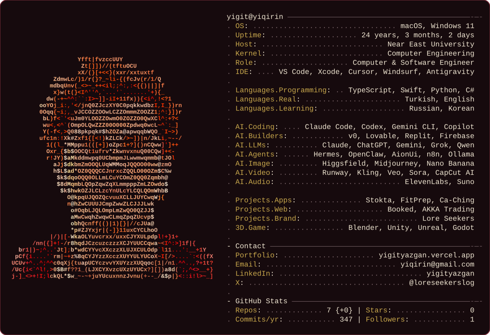
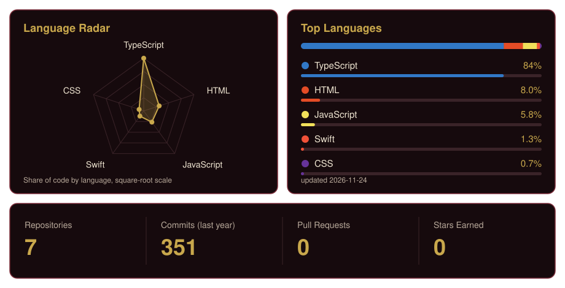

  

## 🧭 About Me

- 🎓 **Computer Engineering** @ Near East University, graduating 2027
- 🛠️ I take products **end to end**: interface, code, server, launch and marketing
- 🤖 Sharpening **AI engineering** (LLMs, agents, tooling) on top of full-stack and mobile
- 💼 Marketing & content at **İrismo Trading** since Dec 2024
- 🎮 Game dev and 3D on the side: Unity, Unreal Engine 5, Godot, Blender
- ✍️ Founder of **[Lore Seekers](https://www.loreseekers.com)**: games, anime and the stories behind them
- 🤝 Open to **software, AI engineering and product** roles, and freelance work

## 📫 Connect With Me

  
  
  
  
  
  
  

 

## ⭐ Featured Projects

<table>
<tr>
<td width="50%" valign="top">

### 📦 Stokta
 

Stock & price tracker: paste a product link, get a push when it's back in stock or cheaper. Tested on 20 Turkish stores.

- ⚡ Prototype → App Store submission in **9 days**, solo
- 🔒 Crash-safe worker scheduler with `FOR UPDATE SKIP LOCKED`
- 🧩 Tiered product reader + 5 custom store adapters

`Next.js` `Capacitor` `Swift` `PostgreSQL` `Prisma` `RevenueCat` `Docker` `Hetzner`

**[Details →](https://yigityazgan.vercel.app/klasik/#projects)**

</td>
<td width="50%" valign="top">

### 💪 FitPrep
 

Weekly training programs from goal, equipment and experience, plus calorie and macro tracking with a Turkish food library.

- 📱 **30 screens**, ~**34k lines** of TypeScript
- 🗄️ 23-table PostgreSQL schema, 36 migrations, row-level security
- 🧠 UI-independent rule engine (Mifflin-St Jeor, Epley/Brzycki 1RM)

`React Native` `Expo` `TypeScript` `Supabase` `TanStack Query` `Zustand`

**[Details →](https://yigityazgan.vercel.app/klasik/#projects)**

</td>
</tr>
<tr>
<td width="50%" valign="top">

### 💸 Ca-Ching
 

Personal cash-flow forecasting: month-end and daily balance from income, bills, subscriptions and credit cards.

- ✅ Forecast package with **30+ unit tests**
- 🏦 Credit-card statement model based on BDDK & TCMB rules
- 🔐 **0** third-party libraries, data never leaves the device

`Swift` `SwiftUI` `SwiftData` `Swift Charts` `XCTest`

**[Details →](https://yigityazgan.vercel.app/klasik/#projects)**

</td>
<td width="50%" valign="top">

### ✂️ Booked
 

Discovery and booking platform for Northern Cyprus: salons, barbers, clinics and more.

- 🔎 Search by service, city and time
- 🗂️ Category browsing with ratings and prices
- 🏪 "List your business" onboarding

`Web Platform` `Marketplace` `UI/UX`

**[booked.com.tr →](https://booked.com.tr)**

</td>
</tr>
</table>

## 💼 Experience & Client Work

| Where | What |
|---|---|
| **İrismo Trading** · Dec 2024 – Present | Marketing Assistant, Head of Content, Social Media Manager. Content, video, influencer and email marketing for İrismo Store, Otofolio and DerdiniPaylaş. Designed and coded **6 HTML email campaigns** (Klaviyo, Mailchimp, Gmail dark-mode support). |
| **AKKA Trading** · Client | Multilingual (TR / EN / RU) corporate website for an international trade and logistics company. **[akka.com.tr →](https://akka.com.tr)** |

## 🖥️ whoami

<picture>
  <source media="(prefers-color-scheme: dark)" srcset="https://raw.githubusercontent.com/Yiqirin/Yiqirin/main/assets/neofetch-dark.svg">
  <source media="(prefers-color-scheme: light)" srcset="https://raw.githubusercontent.com/Yiqirin/Yiqirin/main/assets/neofetch-light.svg">
  
</picture>

## 🛠️ Tech Stack

**Languages**

   

**Mobile (iOS & Cross-platform)**

  
  
  
  
  
  
  
  
  
  
  
  
  

**Web**

   
  
  

**Backend, Data & Infra**

   
  
  
  
  
  
  

**AI · Coding Agents & IDEs**

  
  
  
  
  
  
  

**AI · App Builders**

  
  
  
  

**AI · LLMs & Research**

  
  
  
  
  
  
  
  

**AI · Agents, Automation & Local Models**

  
  
  
  
  

**AI · Image, Video & Audio**

  
  
  
  
  
  
  
  
  
  
  
  

**Creative & Game Dev**

   
  
  
  
  
  

**Marketing, E-commerce & CMS**

  
  
  
  
  
  

**Tools**

   

## 📊 GitHub Analytics

  

  

## 📈 Contribution Graph

  

## 🏆 GitHub Trophies

  

## ✍️ Random Dev Quote

  

